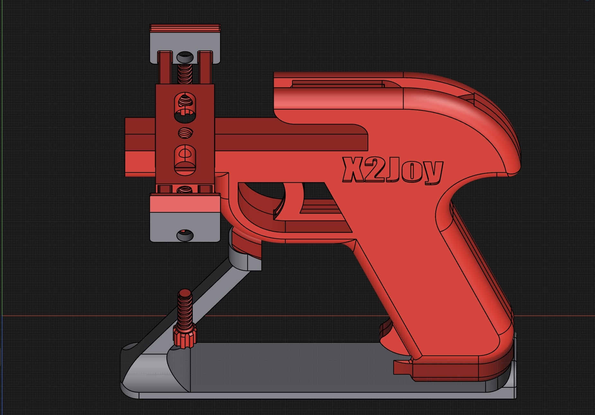
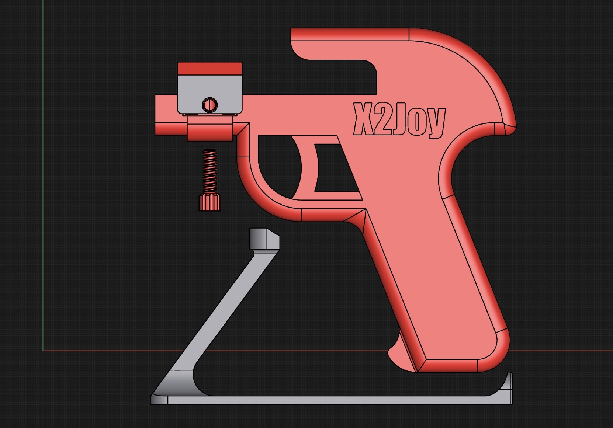
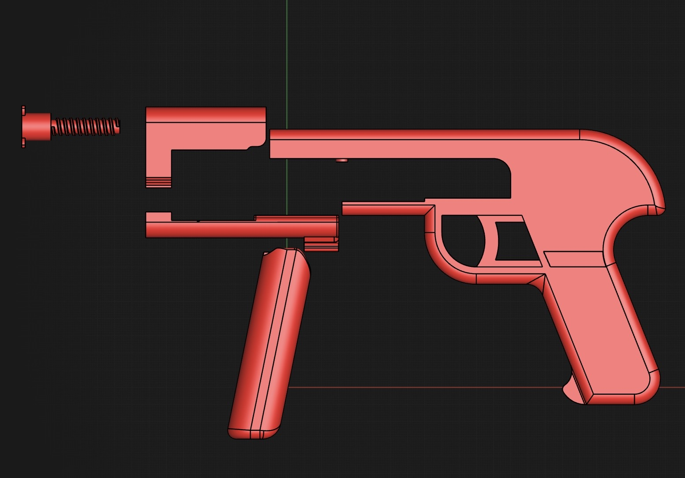
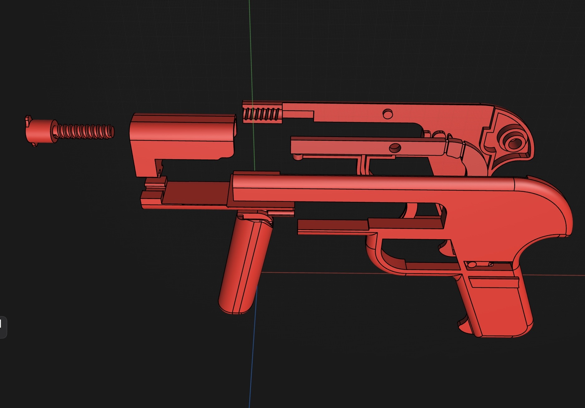

# 3D Models

[简体中文](README.md)

Open-source 3D-printable accessories for X2Joy. Model files are licensed under **CC BY 4.0** — free to use, modify, and commercialize with attribution to X2Joy.

## 📦 Model List

| Model | STL File | Previews | Size |
|-------|----------|----------|------|
| Open Model 1 | [X2Joy-Open-v1.stl](open-v1/X2Joy-Open-v1.stl) | [Preview 1](open-v1/preview-1.jpg) · [Preview 2](open-v1/preview-2.jpg) | 11 MB |
| Open Model 2 | [X2Joy-Open-v2.stl](open-v2/X2Joy-Open-v2.stl) | [Preview 1](open-v2/preview-1.jpg) · [Preview 2](open-v2/preview-2.jpg) | 8.8 MB |

## 🖼️ Open Model 1

## 🖼️ Open Model 2

## 🖨️ Print Notes

- Format: STL
- Check the model dimensions, orientation, and support placement in your slicer before printing
- Adjust layer height, infill, and material to the model and your printer

## 📜 License

**CC BY 4.0** — free to use, modify, and commercialize with attribution to X2Joy.

## 📤 Contributing Models

1. Export STL / 3MF files (include print settings if possible)
2. Put them in the appropriate subdirectory and add an entry to the model list
3. Open a pull request

> Large files (>50 MB): upload them to GitHub Releases instead of the repository tree.
